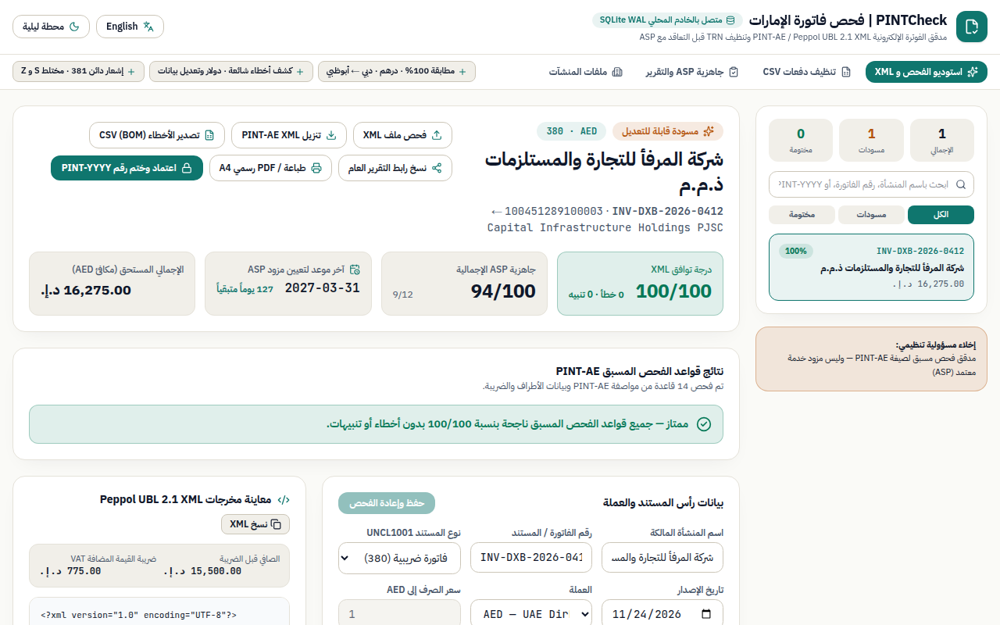
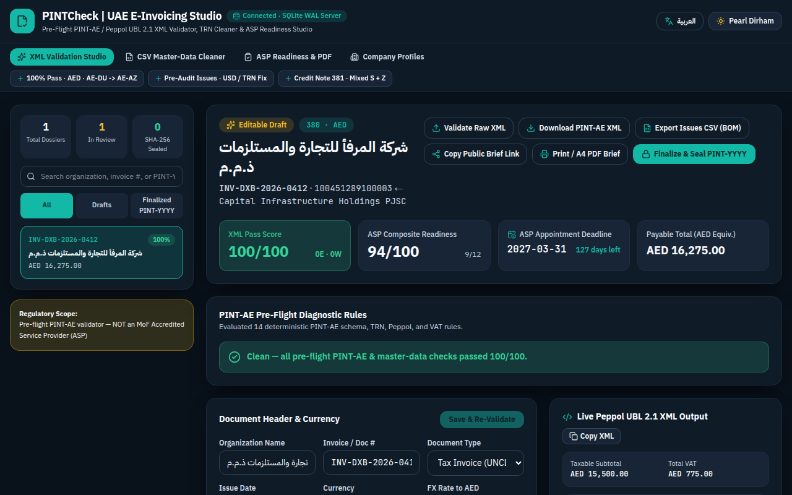
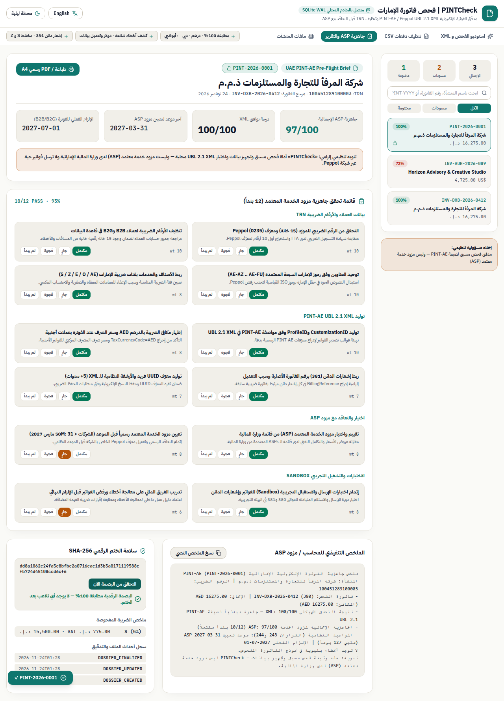
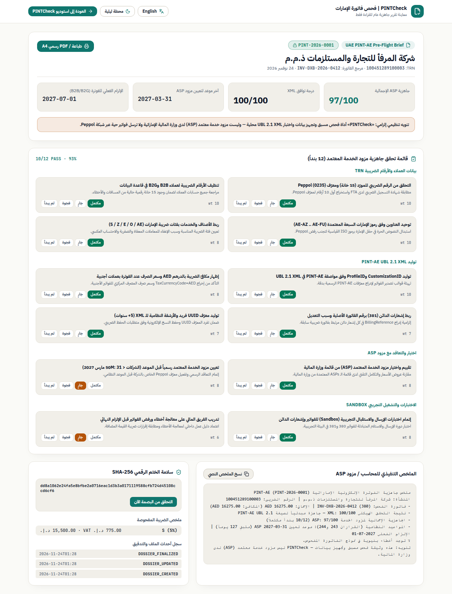
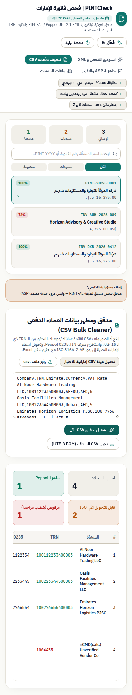
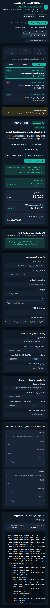

# PINTCheck | فحص فاتورة الإمارات

[](https://github.com/manea/pintcheck/actions/workflows/ci.yml)
[](LICENSE)
**UAE E-Invoicing Pre-Flight Validator, Master-Data TRN & Emirate Cleaner, Peppol PINT-AE (`UBL 2.1 XML`) Generator & ASP Readiness Studio (`AR RTL / EN LTR`).**

**أستوديو الفحص المسبق للفوترة الإلكترونية الإماراتية، وتنظيف الأرقام الضريبية (`TRN`) ورموز الإمارات السبعة، وتوليد ملفات `Peppol PINT-AE (UBL 2.1 XML)` وتقارير الجاهزية قبل التعاقد مع مزود الخدمة المعتمد (`ASP`).**

- **مستودع المصدر المفتوح (GitHub — MIT)**: [`https://github.com/manea/pintcheck`](https://github.com/manea/pintcheck) (`v0.5.0` + GitHub Actions CI).

Built for **UAE SMEs (`< AED 50M`), accounting/tax advisory firms across Abu Dhabi, Dubai & Sharjah, and ERP/billing developers** preparing for **UAE Ministerial Decisions No. 243 & No. 244 of 2025** (`Mar 31, 2027` ASP appointment deadline · `Jul 1, 2027` mandatory B2B/B2G PINT-AE exchange) — featuring calibrated **Pearl Dirham** (`#FAFAF7` + Emirates Deep Teal `#0F766E`) light and **Night Terminal** (`#09111A`) dark themes, Arabic `RTL` by default, and full English `LTR` parity.

---


## UI Previews (لقطات من الواجهة)

### PINT-AE Pre-Flight Validation Studio — Arabic RTL (`Pearl Dirham Light`)


### Pre-Flight Studio — English LTR (`Night Terminal Dark`)


### ASP Readiness 12-Control Checklist & SHA-256 Sealed Brief (`PINT-YYYY-0001`)


### Locked Read-Only Public Readiness Brief (`/r/PINT-YYYY-0001`)


### Mobile Arabic RTL CSV Master-Data TRN & Emirate Cleaner (`390x844`)


### Mobile Arabic RTL Validation Studio (`Night Terminal Dark`, `390x844`)


---
## Core Capabilities (المزايا الأساسية)

- **Deterministic PINT-AE / Peppol UBL 2.1 Engine (`src/core/validator.ts`, `src/core/uaeRules.ts`)**:
  - Validates 15-digit UAE FTA TRNs (warning if missing standard `100` prefix), enforces `EndpointID schemeID="0235"` with matching 10-digit derived Peppol TIN, verifies **ISO 3166-2:AE** codes exclusively (`AE-AZ`, `AE-DU`, `AE-SH`, `AE-AJ`, `AE-UQ`, `AE-RK`, `AE-FU`), and checks foreign-currency invoices (`USD / EUR / GBP / SAR`) for mandatory `TaxCurrencyCode=AED` and dual `AED TaxTotal`.
- **UBL 2.1 XML Generator & XXE-Safe Parser (`src/core/ublXml.ts`)**:
  - Emits PINT-AE compliant `<Invoice>` (`380 / 386 / 480`) and `<CreditNote>` (`381` with `<cac:BillingReference>`) using `urn:peppol:pint:billing-1@ae-1` / `selfbilling-1@ae-1` and `urn:peppol:bis:billing`. Blocks `<!DOCTYPE` / `<!ENTITY` XML External Entity (`400 XXE_BLOCKED`) payloads on both browser and server.
- **1-Click Pre-Flight Auto-Fix & Raw XML Dry-Run (`src/components/InvoiceValidationStudio.tsx`)**:
  - Diagnoses common rejection triggers (`Dubai` free-text -> `AE-DU`, derived `0235` endpoint mismatch, missing `fxRateToAed`, VAT category rate conflicts) and applies one-click remediation with live UBL preview.
- **Customer Master-Data CSV Bulk Cleaner (`src/core/batchCsv.ts`, `src/components/MasterDataBatchPanel.tsx`)**:
  - Parses bilingual EN/AR headers, cleans formatting in 15-digit TRNs, derives `0235:TIN`, maps emirate aliases (`Dubai`, `أبوظبي`, `الشارقة`) to `AE-*` ISO codes, and exports formula-injection neutralized **UTF-8 BOM CSV**.
- **12-Control ASP Readiness Checklist & Sealed Reports (`PINT-YYYY-0001` + `SHA-256`)**:
  - Computes composite readiness against 2027 MoF deadlines, generates printable `A4 PDF` executive briefs with shareable read-only routes (`/r/:slugOrNumber`), and seals finalized reports atomically with `SHA-256`.
- **Static `$0` Browser Fallback (`src/lib/api.ts`)**:
  - Works 100% offline/client-side via `localStorage` (`pintcheck_local_store_v1`) on Cloudflare Workers Static Assets when no Node backend is attached.

> **Mandatory Regulatory Disclaimer**: **PINTCheck** is an offline/self-hosted pre-flight validator, master-data cleaner, and UBL 2.1 XML testing studio — it is **NOT** a UAE Ministry of Finance Accredited Service Provider (**ASP**) and does not transmit live tax invoices over the Peppol network.

---

## Quickstart (التشغيل السريع محلياً)

```bash
cd projects/pintcheck
npm install
npm run typecheck
npm test
npm run build
npm start
# Opens PINTCheck on http://127.0.0.1:4191
```

### Scripts
- `npm run dev` — Run Vite dev server (proxies `/api` to `:4191`).
- `npm run typecheck` — Run TypeScript strict compiler check (`tsc --noEmit`).
- `npm test` — Run Vitest core & server suite (`tests/unit/pintcheckCore.test.ts`, `tests/unit/pintcheckServer.test.ts`).
- `npm run build` — Build production frontend bundle into `dist/`.
- `npm run test:e2e` — Run Playwright Chrome E2E suite across `1280x800` desktop & `390x844` mobile (`tests/e2e/pintcheck.spec.ts` on `:4192`).
- `npm run start:lan` — Serve production build & SQLite API on `0.0.0.0:4191`.

---

## API Reference (`server/app.mjs`)

- `GET /api/health` — Service health, version, `basePath`, and SQLite dossier/profile counters.
- `GET /api/presets` — UAE scenarios (`dubai-trading-compliant`, `abudhabi-agency-errors`, `sharjah-export-credit-note`).
- `POST /api/validate-xml` — Stateless UBL 2.1 XML parser + PINT-AE pre-flight validator (`400 XXE_BLOCKED` on DTD/ENTITY).
- `POST /api/batch-csv` — Stateless customer/vendor CSV TRN & ISO Emirate batch auditor.
- `GET|POST /api/profiles` & `PATCH|DELETE /api/profiles/:id` — Reusable seller legal entity profiles.
- `GET|POST /api/dossiers` & `GET|PATCH|DELETE /api/dossiers/:id` — Pre-flight dossier CRUD & recalculation (`409 DOSSIER_LOCKED` on sealed records).
- `POST /api/dossiers/:id/duplicate` & `POST /api/dossiers/:id/finalize` — Clone drafts or atomically issue sequential `PINT-YYYY-0001` with `SHA-256`.
- `GET /api/dossiers/:id/export.xml`, `/export.csv` (`UTF-8 BOM`), `/summary` — Download UBL XML, cleaned/issues BOM CSV, and executive summary.
- `GET /api/public/reports/:slugOrNumber` — Shareable read-only readiness dossier endpoint (increments `viewCount`).

---

## `$0` Deployment & Sharing

See [`launch/DEPLOY-AND-SHARE.md`](launch/DEPLOY-AND-SHARE.md) for Cloudflare Workers Static Assets (`wrangler.jsonc`), Docker (`Dockerfile`, `docker-compose.yml`), `systemd` + Caddy (`deploy/`), online SQLite WAL backups (`deploy/backup-sqlite.sh`), and ethical community launch drafts.
